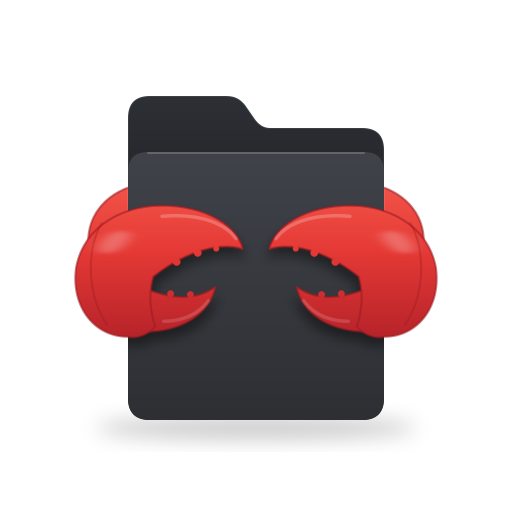
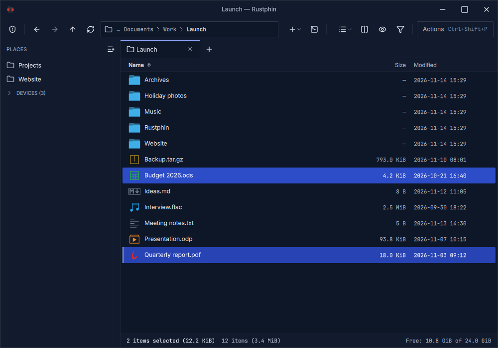
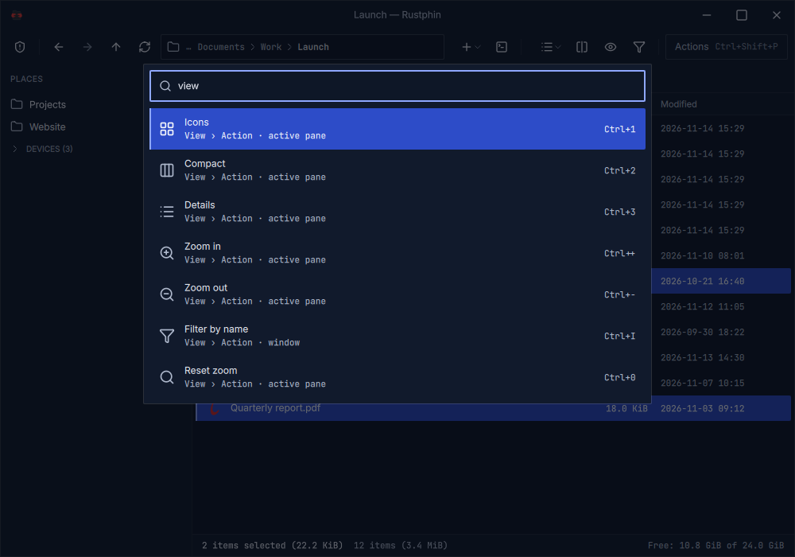

<div align="center">



# Rustphin

**A fast, keyboard-friendly file manager for KDE Plasma on Wayland, written in Rust.**

A re-architecture of KDE's Dolphin with a dark frosted-glass look, place groups,
a command palette and safe batch rename.


</div>



> **Status: 0.1.0, early.** Everything below is implemented and tested, and the
> maintainer is trialling Rustphin as their everyday file manager. Expect rough
> edges: see [what is still open](#status-and-roadmap) before relying on it for
> important work.

## Why Rustphin

- **Fast with huge folders.** A folder of 500,000 files shows its first entries
  in well under 200 ms, re-sorts in under half a second and scrolls at 60 frames
  per second. Listing, sorting, thumbnails and file operations never run on the
  interface thread.
- **Safe with your files.** Every change goes through one operation engine:
  copies are written under a temporary name and only then renamed into place,
  nothing is overwritten unless you say so, *Delete* means the trash, and most
  operations can be undone.
- **Built for the keyboard.** Dolphin's shortcuts where Dolphin has them, plus a
  command palette (<kbd>Ctrl</kbd>+<kbd>Shift</kbd>+<kbd>P</kbd>) that reaches
  every action, place, tab and recent folder by a few typed letters.
- **At home on Plasma.** It reads and writes KDE's own places, uses your icon
  theme and the shared thumbnail cache, answers "Show in folder" from other
  applications, and blurs the desktop behind its window through KWin.

## Features

**Browsing**
- Details, icons and compact views, with zoom, sorting by any column and
  folders first
- Tabs (reopen a closed one with <kbd>Ctrl</kbd>+<kbd>Shift</kbd>+<kbd>T</kbd>)
  and a split view to work in two folders side by side
- Live updates as files change on disk, a filter bar
  (<kbd>Ctrl</kbd>+<kbd>I</kbd>), hidden files on demand and type-to-jump
- Breadcrumbs that turn into an editable location field
  (<kbd>Ctrl</kbd>+<kbd>L</kbd>)

**Places**
- KDE's places, shared with Dolphin, plus **place groups** of your own to
  organise them; fold a group to tidy the panel
- Drives and removable media with their free space; mount, unmount and eject
- Remote folders (`sftp://`, `smb://`…) through KDE's kio-fuse

**Files**
- Copy, move, rename, duplicate, new folder and new file from templates, drag
  and drop and the clipboard, with Dolphin and other applications
- Conflicts asked one by one or for all at once; failures can be retried or
  skipped
- Trash with restore, and undo for most operations
  (<kbd>Ctrl</kbd>+<kbd>Z</kbd>)
- **Batch rename** with find and replace (regular expressions too), patterns
  with counters, or a change of case, and a preview of every new name before
  anything changes. An interrupted batch can be put back exactly.
- **Compress and extract**: ZIP, TAR (gzip, bzip2, xz, zstd) and 7Z built in;
  RAR, ISO, CAB, CPIO, DEB, RPM and more read through libarchive, with 7-Zip as
  the fallback for encrypted archives
- Properties with permissions you can change, *Open with*, and an
  administrator mode for system folders through KDE's own kio-admin helper

**Desktop**
- Set as your default file manager; other applications' "Show in folder" opens
  Rustphin with the file selected
- Keeps running in the background after its last window closes, so the next
  window opens instantly (optional)
- A settings window: general behaviour, views, places and confirmations

<p align="center">
  
  <br>
  <em>The command palette: every action, place, tab and recent folder, a few letters away.</em>
</p>

The screenshots show the opaque theme. On the desktop, the window's background
is frosted glass over whatever is behind it.

## Requirements

Rustphin runs on **Linux with KDE Plasma 6 on Wayland**. It does not support
X11, other desktops' compositors, macOS or Windows.

| | Packages (Arch Linux names) |
|---|---|
| Required | `qt6-base`, `qt6-declarative`, `qt6-wayland`, `qt6-svg`, `kwindowsystem` (KF6), `libarchive` |
| Optional | `7zip` or `unrar` for encrypted RAR and 7Z, `kio-fuse` for remote folders, `kio-admin` for administrator mode |

To build it you also need Rust 1.100 or newer (through [rustup](https://rustup.rs)),
a C++ compiler, and the development files of the packages above, with `qmake6`
on your `PATH`.

## Building and installing

```bash
git clone https://github.com/PerkyZZ999/Rustphin.git
cd Rustphin
cargo build --release --locked --package rustphin
```

The binary is `target/release/rustphin`. Try it straight away:

```bash
target/release/rustphin ~/Documents
```

To install it for your user, with its menu entry and icons:

```bash
install -Dm755 target/release/rustphin ~/.local/bin/rustphin
install -Dm644 assets/rustphin.desktop ~/.local/share/applications/rustphin.desktop
cp -r assets/icons/hicolor ~/.local/share/icons/
install -Dm644 assets/rustphin.svg ~/.local/share/icons/hicolor/scalable/apps/rustphin.svg
```

`~/.local/bin` must be on your `PATH`. To make Rustphin the default file
manager, choose it in *System Settings › Default Applications › File Manager*.

Rustphin keeps running after its last window closes. After installing a new
build, run `rustphin --quit` once so the next launch uses it.

## Using Rustphin

Several folders, or `file://` addresses, open as tabs; a path that names a file
opens its folder with the file selected:

```bash
rustphin ~/Downloads ~/Pictures
```

A few keys worth knowing:

| Keys | Action |
|---|---|
| <kbd>Ctrl</kbd>+<kbd>Shift</kbd>+<kbd>P</kbd> | Command palette: actions, places, tabs and recent folders |
| <kbd>Ctrl</kbd>+<kbd>L</kbd> | Type a location |
| <kbd>F3</kbd> | Split view; <kbd>Shift</kbd>+<kbd>F5</kbd> / <kbd>Shift</kbd>+<kbd>F6</kbd> copy or move to the other side |
| <kbd>F2</kbd> | Rename; with several files selected, batch rename |
| <kbd>Ctrl</kbd>+<kbd>1</kbd> <kbd>2</kbd> <kbd>3</kbd> | Icons, compact or details view |
| <kbd>Ctrl</kbd>+<kbd>Shift</kbd>+<kbd>D</kbd> | Add the current folder to the places |
| <kbd>Ctrl</kbd>+<kbd>Z</kbd> | Undo |

Every shortcut, compared with Dolphin's, is listed in
[`docs/project/KEYBOARD.md`](docs/project/KEYBOARD.md).

If a batch rename was ever interrupted, open the folder, press
<kbd>Ctrl</kbd>+<kbd>Shift</kbd>+<kbd>P</kbd> and run **Recover original names
after interruption**. Rustphin checks the record it keeps and puts every name
back; if anything looks wrong it stops and keeps the record, because the staged
files may hold the only copy of an original.

Set `RUSTPHIN_OPAQUE=1` to turn off translucency, and `RUSTPHIN_LOG=debug` for
detailed logs on standard error.

## Privacy

Rustphin makes no network connections of its own and collects nothing. It
saves its settings, tabs, place groups and recent folders under your home
folder; [`docs/project/PRIVACY.md`](docs/project/PRIVACY.md) lists every file
it writes and how to clear them.

## Status and roadmap

Version 0.1.0 covers browsing, tabs, split view, places and devices, file
operations with undo, trash, drag and drop, thumbnails, the command palette,
batch rename, compress and extract, properties, settings, administrator mode
and desktop integration.

Still open before it can be called a Dolphin replacement:

- a few checks that need real hardware (USB drives, a physical high-refresh
  display) and a full accessibility pass with a screen reader;
- search, an information panel, a quick preview and KDE's service menus;
- packaging and translations.

The current state, open items and next steps are tracked in
[`docs/project/STATE.md`](docs/project/STATE.md) and
[`docs/project/WORK_ITEMS.md`](docs/project/WORK_ITEMS.md).

## How it is built

Rustphin is a Cargo workspace of four layers, each depending only on the ones
below it:

| Crate | What it holds |
|---|---|
| `rustphin-core` | Folder listing and sorting, selection, history, the file operation engine with undo, batch rename and archives. No user interface. |
| `rustphin-platform` | The desktop: clipboard, devices, trash, thumbnails, places, MIME types and icons, D-Bus services, libarchive. |
| `rustphin-view` | Interface logic without any toolkit: commands and keys, menus, panes, tabs, places panel, settings, design tokens. |
| `rustphin` | The application: Qt 6 Quick and QML through [cxx-qt](https://github.com/KDAB/cxx-qt), and a small C++ shell. |

Almost all behaviour lives in the first three crates, where it is tested
without a display: about 930 tests, fault injection for every file operation,
property tests, fuzzing of the parsers and mutation testing. The design is in
[`docs/project/ARCHITECTURE.md`](docs/project/ARCHITECTURE.md), the decisions
behind it in [`docs/project/DECISIONS.md`](docs/project/DECISIONS.md), and the
visual design in [`docs/DESIGN.md`](docs/DESIGN.md).

## Contributing

Issues and pull requests are welcome. Before sending a change:

```bash
cargo fmt --all
cargo clippy --workspace --all-targets -- -D warnings
cargo nextest run --workspace     # or: cargo test --workspace
```

The maintainer's full gate, `rust-tc doctor`, also runs `cargo-deny`,
`cargo-shear`, the layering check, the minimum Rust version and the QML linter;
its recipes are in the [`justfile`](justfile). [`AGENTS.md`](AGENTS.md)
describes the project's rules: file names are bytes, every file change goes
through the operation engine, no work on the interface thread, and a failing
test before every bug fix.

## Licence and credits

Rustphin is free software under the **GNU General Public License v3.0 or
later** ([`LICENSE`](LICENSE)). Every dependency's licence is checked against
[`deny.toml`](deny.toml).

It follows the behaviour of [Dolphin](https://apps.kde.org/dolphin/) and works
alongside KDE's own services. It bundles [Lucide](https://lucide.dev) icons (ISC,
[`LICENSE-LUCIDE`](crates/rustphin/icons/LICENSE-LUCIDE)) and the typefaces
Inter, Space Grotesk and JetBrains Mono (SIL Open Font License,
[`crates/rustphin/fonts`](crates/rustphin/fonts)).
