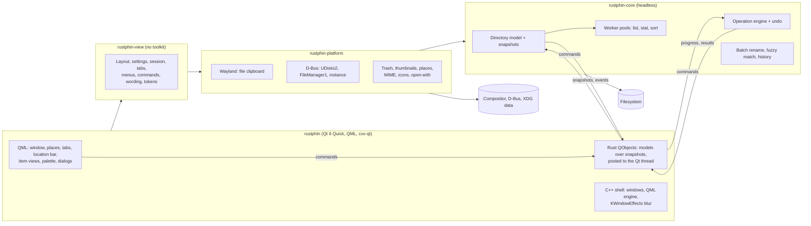

# Architecture

Status: drafted 2026-10-12, consistent with locked decisions D-001 to D-003, D-006, D-008 to D-011 and D-017.

## Overview

Rustphin is a single desktop process built as a Cargo workspace of four layers. Dependencies point one way: the interface (`rustphin`, Qt 6 and QML through cxx-qt, D-034) depends on the interface logic (`rustphin-view`), which depends on the platform layer, which depends on the core; nothing below the interface depends on Qt. All filesystem and desktop work happens off the UI thread; the interface renders immutable snapshots and sends commands. Until W-114i (2026-11-14) the interface was `rustphin-ui`, built on GPUI-Kit (D-001); the last GPUI version is commit 72ccb06.

## Components

| Crate | Responsibility | Notes |
|---|---|---|
| `rustphin-core` | Directory model, entry storage, listing, lazy metadata, sorting, filtering, selection, navigation history, operation engine, undo, batch-rename planner, fuzzy matcher, config schema | No UI, Wayland or D-Bus dependencies. Synchronous, cancellable API on its own worker pools (D-009). Filesystem reached through an `Fs` trait so tests can inject faults. |
| `rustphin-platform` | File clipboard (Wayland data-control), UDisks2 devices, `FileManager1` service, single-instance bus service, freedesktop trash, thumbnail cache and generators, shared places file and place groups, MIME detection, icon-theme lookup, launching applications, administrator helper client, kio-fuse remote folders, atomic config I/O | Each capability is a trait with a real implementation and a fallback or mock (D-010). No interface-toolkit dependency. |
| `rustphin-view` | Interface logic free of any toolkit: pane wording and status line, settings store and Settings pages, session and tabs, toolbar items, menus, command table, questions, dialogs (Properties, Compress, batch rename), places panel rows, the numeric design tokens (`metrics`) and colours with their contrast tests | No Qt or GPUI dependency (W-114b, D-034); unit-tested headlessly. |
| `rustphin` (binary) | The Qt 6 and QML interface: QML files (`qml/`), Rust QObjects through cxx-qt (each bridge alone in a `*_bridge.rs` file of declarations, D-034), the C++ shell (`cpp/`: windows, the QML engine, blur), wiring of platform services and the core | Never calls the filesystem directly for changes (D-011); listing and metadata come from the core's snapshots. Logs to stderr (`RUSTPHIN_LOG`). |
| `justfile` (via `rust-tc`) | Developer commands and the quality gate: checks, layering check, minimum-version build, benchmarks | Not shipped. The user's Rust-Toolchain; replaces the `xtask` crate first planned. |

### Core internals

- **Entry store.** One store per open directory. Names live in a single byte arena (names are bytes, not assumed UTF-8); per-entry fields (kind, size, modified time, name offset) are kept in parallel columns. Metadata columns are filled lazily.
- **Lister.** Reads the directory in batches on an I/O worker and publishes the first batch immediately. Metadata is fetched in priority order: visible rows first, then the rest in the background; all of it up front only when the active sort key needs it.
- **Sorter.** Produces an index (a vector of entry indices) on the CPU pool. Natural, case-insensitive comparison; folders-first as an option.
- **Snapshot.** An immutable, cheaply shared view: entry store reference, sort index, filter, generation number. The UI reads row *n* in constant time. New snapshots replace old ones; selection is carried across by entry identity. Manual refresh, like a watcher refresh, retains the current view until the complete replacement is ready. Selection matching by name runs on the core worker pool; the UI applies the result only if its selection revision still matches, otherwise it requests matching for the newer selection. During navigation the UI renders/acts on a snapshot only when its path matches the requested location; the previous snapshot remains available for failed-navigation rollback.
- **Watcher.** inotify events are coalesced into batched changes applied to the store, followed by an incremental re-sort.
- **Operation engine.** Plan → validate → execute → record completed changes for undo. Plans are data, so they can be previewed (conflicts, batch rename) and tested. Execution follows the D-011 rules. Normal undo history is in memory; batch rename and batch undo additionally write a synced recovery record before moving entries (W-071). Regular-file copies sync content and attributes through their open destination handle before reporting success, before the engine publishes the temporary name. Copied folders sync attributes/entries bottom-up through handles opened before final modes. Cross-filesystem moves additionally sync the published destination parent before deleting any source. A failed publication sync keeps the source and the copy record; retry syncs only. Complete source removal syncs its parent and reports late errors without repeating the move (W-072b). Partial source-tree removal and physical power-loss behaviour are not proven.

### Batch-rename recovery contract (W-071)

- Each affected directory has at most one `.rustphin-rename-journal`. Its presence blocks a new batch rather than overwriting the record. An exclusive nonblocking directory lock serialises Rustphin's batch apply, undo and recovery. It does not lock out unrelated applications.
- The private record is written and file-synced, then its directory is synced before any selected entry moves. Version 1 is binary: `RUSTPHIN-RENAME` plus version byte 1; little-endian directory device/inode and entry count; then each original, temporary and final name (u16 byte length plus raw bytes), kind, device, inode, size, modification nanoseconds and mode. Reads are bounded to 64 MiB and refuse links/nonregular files, malformed lengths, unknown versions, unsafe/duplicate names, wrong directories and trailing data.
- Recovery is explicit through `Request::RecoverRenameBatch` or `recover_rename_batch`; the palette command is **Recover original names after interruption**. Browsing and startup never mutate files to recover them. Only recorded paths in that directory are considered; no path is inferred from a temporary prefix.
- Before moving anything, recovery matches every entry's recorded kind, device, inode, size, modification time and mode, and checks that every occupied destination belongs to the batch. Moves use no-replace rename and recheck entry identity. Missing/edited entries or occupied original names refuse preflight without changes. Later I/O errors can leave a partial recovery; the record remains and the same command can be retried.
- Recovery restores original names, including swaps and an interrupted recovery. With no record it syncs the directory without moving entries (also retries a prior late cleanup sync). Record identity is checked before cleanup; a record another program changed is kept. Ordinary apply errors attempt rollback; successful apply/rollback checks the record identity again before cleanup. Batch undo uses the same recorded transaction path.
- This proves recoverability after explicit recovery, not atomic multi-entry rename at the instant of SIGKILL. Older unjournaled staging files cannot be safely inferred. W-072c syncs completed/rolled-back names before record removal and the directory again afterwards. A failure before removal retains the recovery path; a sync failure after removal reports visible committed names and never rolls back without a record. Power loss, physical-device errors and externally racing namespace changes remain outside the kill/fault proof; no R-103 checkbox was relaxed.

### Namespace limitations (W-072b)

- `Fs::rename_new` requires kernel no-replace rename support. Unsupported filesystems now fail instead of using the former stat/ordinary-rename fallback, which could overwrite a concurrently created entry. An explicit replace still uses `rename_over`.
- Directory sync errors are actionable operation failures. If copied-directory sync/attributes fail and the user skips, that complete source subtree is kept; the partial destination stays visible with a failure note. Regular copy publication and same-filesystem moves do not yet have a complete namespace-durability contract. Whole cross-filesystem moves sync destination first, source removal last; partial-source removals can reappear as duplicates after a crash. These barriers do not serialize unrelated applications modifying names/content between validation and mutation.

### Atomic configuration writes (W-072a)

- Configuration, session, shared-place edits and history use `config::write_atomic`. Each writer exclusively creates a private (0600) temporary file, avoiding links and concurrent truncation, syncs file content, atomically renames it, then syncs the containing directory. Missing directories and their parent entries are synced while creating the path.
- A pre-publication error cleans only the temporary file created by that writer. A post-publication directory-sync error reports that the replacement is already visible; callers cannot assume an error leaves the old contents. Cleanup errors are also reported. Existing UI callers already handle errors. This does not prove physical power-loss safety or serialize competing read/modify/write edits.

### Session publication ordering (W-077e)

- Each workspace issues checked revision tickets before dispatching session snapshots. TOML encoding and configuration I/O stay on the background executor. A worker-only mutex covers the revision check and complete atomic write; preparing a ticket never takes it on the UI thread.
- A completed or failed newer publication attempt retires older pending tickets. They cannot restore closed tabs after the newer attempt. An earlier in-flight write finishes before a newer one publishes. Errors remain reported; atomic-file durability is still the W-072a contract.
- This orders one workspace's saves. It is not a cross-process merge, a shutdown flush guarantee or protection against a separate process writing the same file.

### Byte-safe session paths (W-077f)

- Session format 2 stores pane paths as local file URIs through the platform's byte-preserving URI codec. Valid version-1 UTF-8 absolute paths remain readable, with literal percent signs preserved; supported formats normalize to version 2 and upgrade on the next save.
- Remote URI hosts, relative paths and embedded NUL are rejected before pane/tab clamping. Serialization returns its error rather than an empty document; the background publication job reports InvalidData before replacing any file. Revision retirement covers encoding as well as I/O attempts.
- Newer-version parsing/write protection remains under W-077 review; this format change does not claim that unknown future schemas or read failures are handled safely yet.

### Font preparation (W-073b, W-109b; GPUI only)

- The GPUI interface pre-read fonts before its first window; the Qt interface bundles the design's static faces (`crates/rustphin/assets` through `fonts`) and lets Qt's own font database do the rest. The pre-read module left the platform layer at W-114i.

### Performance diagnostics (W-073a)

- `RUSTPHIN_FRAME_LOG` measures view descriptions, model/selection updates and visible-row construction. `RUSTPHIN_SCROLL_BENCH` drives 1,200 frames; an active benchmark never discards a long interval as idle. All excluded idle/startup gaps are counted with their longest duration.
- The GPUI-only `diagnostics` feature (toolkit profiler) was removed with GPUI at W-114i; frame timing and the scroll benchmark are measured in the Qt interface by the same variables.

## Data flow

1. The user acts in a view; the view dispatches an action.
2. The bridge sends a command over a channel to the core (for example "open directory", "sort by size", "copy these to there").
3. Core workers do the work and publish snapshots, progress or results on a channel.
4. The bridge receives them on a worker thread and posts the update to the Qt thread (`post::on_qt`, or a cxx-qt thread handle), where the model emits row changes; Qt Quick redraws only the visible delegates.
5. Desktop effects (clipboard, mount, trash) are calls from the interface or the core's operation engine into platform traits; blur is requested from KWin by the C++ shell (`KWindowEffects`).

Stale results are discarded by generation number, so a fast navigation never shows a previous directory's late results.

## Trust & boundaries

- **Authn/z:** none of its own. Rustphin runs with the user's permissions and never elevates itself.
- **Acting as administrator (W-098, D-028; design and threat model in ADMIN_MODE.md):** the one privileged path is KDE's own `kio-admin` helper on the system bus. Rustphin never asks for, sees or stores a password: polkit (`org.kde.kio.admin.commands`, `auth_admin_keep`) authorises Rustphin's own bus connection, and KDE's agent asks. The mode belongs to one window, is marked (red shield, bar, title) and is never saved. `AdminFs` (platform) is the only code that talks to the helper; the core sees it as one more `Fs`, so every change still goes through the operation engine (temporary name, verify, no silent overwrite, D-011). Data from the helper is untrusted: `UDSEntry` parsing is bounded and fuzzed (`admin_entry`); only plain absolute UTF-8 paths that round-trip exactly are sent, as percent-encoded `file://` URLs. KIO applies modes exactly, so new folders get the user's umask first. The helper offers no trash, watching, locks or `fsync`: delete is always permanent and confirmed, panes re-read after each change, batch rename is off, and a move across filesystems keeps its source.
- **Archives (W-111, D-032, D-036):** archives are untrusted. ZIP, TAR and 7Z are parsed by Rust crates; every other format by libarchive, a C library loaded from the system (`rustphin-platform::libarchive`, Rustphin's own small binding: names stay bytes, nothing from libarchive is kept past its call), else by 7-Zip or unrar run as a separate process into a private `0700` folder in `~/.cache/rustphin` that is always removed. Whichever reads it, the engine gets entries one by one and alone decides what is written: names are checked (`archive::entry_path`), links must stay inside, only files, folders and such links are made, and everything is written through `Fs` under temporary names. A memory-safety fault in libarchive would be in-process; it is the system's own library, kept current by the distribution, and the same one Ark and Dolphin's previews use. A tool gets the engine's password on its command line, readable by the user's own processes while it runs. The reader of other formats is handed to the engine with its `Fs` and `Trash` (`archive::ForeignReader`, implemented by `archive_tool::ForeignArchives`, W-129): libarchive reads the content the engine opened through `Fs`; only a tool opens the archive by its path, so the administrator runner gets a reader without tools and refuses what libarchive cannot read.
- **Untrusted input:** directory contents (names with control characters or invalid UTF-8), file contents handed to thumbnailers, `.desktop` files, the shared places file, clipboard and drag payloads from other applications, and `FileManager1` requests from any local process. All are parsed defensively; none can trigger execution. Activating an executable or `.desktop` file asks first.
- **Thumbnailing:** uses memory-safe decoders with size and time limits, on workers isolated from the UI thread; failures yield a placeholder.
- **Data sensitivity:** paths and names of the user's files. They stay on the machine: no network use, no telemetry (R-108). Warnings/errors can include paths at the default log level; see PRIVACY.md for retention and clearing.
- **Data retention/deletion:** PRIVACY.md inventories config, session tabs, palette history, per-directory recovery records, shared data and stderr. Palette history has a clear command; saved tabs need offline removal after all instances quit. Shared places, trash and thumbnails have separate retention and clearing rules.
- **External calls:** Wayland compositor, session D-Bus (FileManager1/accessibility), system D-Bus (UDisks2), launched applications. The pinned toolkit retains network-capable dependencies; no application HTTP client is installed. Environment-selected D-Bus transports are not restricted to Unix. R-108 validation remains open (PRIVACY.md).

## Failure modes

| Failure | Detection | Response / recovery |
|---|---|---|
| Directory unreadable or vanishes while open | Error from listing or watcher | Inline error state; navigate to nearest existing parent on removal |
| Copy or move interrupted (crash, power loss, cancel) | Operation error/cancel, or temporary-name files left after a crash | Error/cancel paths attempt temporary-copy cleanup; copied regular files are synced before publication. Fault tests cover copy/move; a process-kill test covers cross-filesystem moves. Namespace ordering, copy restart cleanup and power-loss validation remain open (W-072) |
| Batch rename or its undo interrupted | Per-directory recovery record with staged/original/final entries | Explicit validated recovery restores original names; interrupted recovery is retryable. Unknown or changed entries and records are retained, never guessed at or replaced (W-071) |
| Destination full or permission denied mid-operation | I/O error from worker | Operation pauses with skip / retry / cancel; completed items stay journaled for undo |
| Shared places file changed or malformed | Watch event; parse error | Reload; on parse error keep last good in-memory state and never write over the file |
| Place-group file refers to a vanished place ID | Reconciliation at load and on change | Drop the member silently; keep the group |
| Blur protocol missing or request fails | Runtime protocol detection | Opaque theme (D-017, D-010) |
| Data-control protocol missing | Runtime protocol detection | In-app clipboard only, with a one-time notice |
| UDisks2 absent or unresponsive | D-Bus error or timeout | Devices section hidden with a notice; rest of the app unaffected |
| Thumbnail decoder fails or exceeds limits | Error or timeout on worker | Placeholder icon; entry marked failed in the shared cache per the spec |
| Worker panic | Panic caught at pool boundary | Task reported failed; pool keeps running; error logged |
| Administrator helper missing, refuses, or times out | Service file check; polkit refusal (empty command path); 120 s limit per command | Shield dimmed with how to install kio-admin; "not granted" notice and the mode stays off; a timed-out operation fails with its reason |
| Toolkit upgrade breaks borrowed Wayland connection | Regression ui-tests from the spike scenarios | Stay on the pinned version until fixed (D-001) |

## Test strategy

- **Unit and property tests (core):** sorting, natural comparison, snapshot consistency, selection carry-over, rename planner, fuzzy ranking, operation plans. Property tests generate directory trees and operation sequences and check invariants (no data loss, undo restores state).
- **Fault injection (core):** the `Fs` trait fails or "crashes" at every step of copy, move and batch rename; assertions check the D-011 rules. Kill tests run a child process against a temporary directory.
- **Integration and contract tests (platform):** places file round trips against fixtures from a real Dolphin; trash and thumbnail cache against their specifications; UDisks2 and FileManager1 against a mocked bus.
- **Benchmarks:** headless listing, metadata and sort on generated 500,000-entry directories; results tracked over time (R-101, R-102).
- **Accessibility:** (Qt, since W-114i) Qt Quick exposes the views over AT-SPI: entries are list items by name with their selected state, buttons are named with actions, dialogs carry their title (W-114h). The rest of this paragraph describes the GPUI interface it replaced: the pinned Wayland adapter follows the session accessibility status. Entry rows expose names, selection and active-descendant focus through the public GPUI API; virtualised items carry positions and their container carries the total count and multiselectable capability. Sort controls are siblings of the selectable collection. Accessibility clicks toggle file selection for the adapter selection interface; ordinary pointer clicks retain their own modifier behavior. An active AT-SPI bus alone does not enable exposure. Places use real group/child ancestry and expose focus/activation; tabs expose their collection, names and selected state. The pinned Unix adapter does not translate expanded state, so group descriptions also state it; the native flag remains an open finding. Input focus and remaining composite widgets remain S11 work; there is no Orca pass (D-023).
- **UI tests:** scripted scenarios in an isolated KWin session with an isolated home, alongside the installed Dolphin: navigation, drag-and-drop, clipboard, tabs, palette. Frame timing collected for scrolling.
- **Fuzzing:** the separate `fuzz/` workspace targets places parsing/edits, desktop classification/Exec parsing, URI lists/name display and image thumbnail generation. `rust-tc fuzz <target> [seconds]` runs a bounded libFuzzer/AddressSanitizer campaign from reviewed seeds against generated scratch data. The harness checks preserved bytes and successful-edit/cache contracts as well as crashes. `rust-tc doctor` includes harness formatting, lint and dependency-policy checks; campaigns run explicitly. libFuzzer never ships in the application.
- **Manual checklists:** keyboard-only operation, visual review on the real desktop, real USB drive, a non-KDE drop target.
- **Risk-specific:** no file-operation UI is usable on real data until the engine's fault-injection suite passes.

## Operability

- **Config:** TOML under `$XDG_CONFIG_HOME/rustphin/` (global view settings, place groups) and `$XDG_STATE_HOME/rustphin/` (session tabs, recent folders). Formats carry version fields; newer versions are protected from writes. There is no general migration/backup framework or configurable key-binding file. Writes use synced temporary files and atomic rename (W-072a); see PRIVACY.md.
- **Secrets:** none are stored or handled.
- **Logging/metrics:** `tracing` to stderr, filtered by `RUSTPHIN_LOG` (default `info`); no application log file, rotating store or diagnostics view. Opt-in `RUSTPHIN_FRAME_LOG` and the diagnostic build expose timings in stderr. No telemetry collector is configured. Logs can contain paths; see PRIVACY.md.
- **Migrations:** only Rustphin's own config files; shared files are never migrated.
- **Rollback sketch:** Rustphin never replaces Dolphin. Reverting means changing the default file manager back; shared data (places, trash, thumbnails) stays valid for Dolphin at all times. Releases are tagged so a previous build can be reinstalled.
- **Checks:** `rust-tc doctor` runs format, clippy, tests, doctests, `cargo-deny` (advisories, licences, bans, sources), `cargo-shear`, feature checks, the layering check and a compiler check on Rust 1.100 (D-035; not a linked clean build). `rust-tc build` links the locked release application without launching it. `rust-tc validate` runs doctor and both headless listing/palette benchmarks sequentially, propagating failures. All local; the repository is on GitHub (D-037) but there is no hosted CI.

## Alignment to locks

- D-001 → superseded by D-034 (W-114i): the interface is Qt 6 and QML through cxx-qt in the `rustphin` crate; `deny.toml` bans `gpui-kit` and `gpui-pre`.
- D-002 → four layers with one-way dependencies, enforced by `rust-tc layers` (no Qt below the interface, no GPUI anywhere).
- D-003 → every crate declares GPL-3.0-or-later; licences checked by `cargo-deny`.
- D-006 → Wayland-only features compiled; no X11 backend.
- D-017 (supersedes D-007) → the tokens in `rustphin-view` (`colors`, `metrics`) implement `docs/DESIGN.md`; `crates/rustphin/src/tokens.rs` hands them to QML; the opaque theme is used when KWin offers no blur or `RUSTPHIN_OPAQUE` is set.
- D-008 → `places` module in the platform layer reads/writes the shared file and a separate groups file keyed by place ID.
- D-009 → core-owned worker pools, snapshots over channels, no async runtime in the core.
- D-010 (amended by D-034) → the file clipboard trait in `rustphin-platform` with runtime detection and an in-app fallback; blur comes from KDE's `KWindowEffects` on each window, with the opaque theme when it is unavailable. The GPUI-era borrowed-connection blur and its monitor left with GPUI (W-114i).
- D-011 → single operation engine in the core; UI has no filesystem access; `Fs` trait for fault injection.
