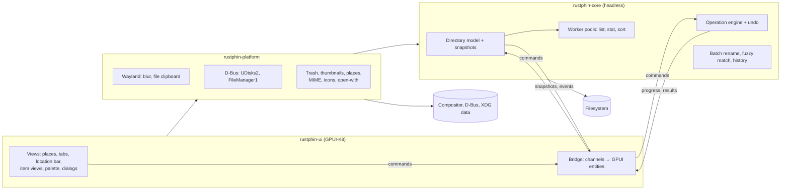

# Architecture

Status: drafted 2026-10-12, consistent with locked decisions D-001 to D-003, D-006, D-008 to D-011 and D-017.

## Overview

Rustphin is a single desktop process built as a Cargo workspace of three layers plus a thin binary. Dependencies point one way: the UI depends on the platform layer and the core; the platform layer depends on the core; the core depends on neither. All filesystem and desktop work happens off the UI thread; the UI renders immutable snapshots and sends commands.

## Components

| Crate | Responsibility | Notes |
|---|---|---|
| `rustphin-core` | Directory model, entry storage, listing, lazy metadata, sorting, filtering, selection, navigation history, operation engine, undo, batch-rename planner, fuzzy matcher, config schema | No UI, Wayland or D-Bus dependencies. Synchronous, cancellable API on its own worker pools (D-009). Filesystem reached through an `Fs` trait so tests can inject faults. |
| `rustphin-platform` | Wayland integrations (blur, file clipboard), UDisks2 devices, `FileManager1` service, freedesktop trash, thumbnail cache and generators, shared places file and place groups, MIME detection, icon-theme lookup, launching applications, atomic config I/O | Each capability is a trait with a real implementation and a fallback or mock (D-010). No GPUI dependency, apart from accepting raw window handles for blur. |
| `rustphin-ui` | Theme tokens, views, actions and key bindings, the bridge that turns core channels into GPUI entity updates | Only crate that depends on `gpui-kit` (D-001, D-002). Never calls the filesystem directly (D-011). |
| `rustphin` (binary) | Composition root: parses arguments, builds platform services, starts the core and the UI | Thin; holds no logic. |
| `justfile` (via `rust-tc`) | Developer commands and the quality gate: checks, layering check, minimum-version build, benchmarks | Not shipped. The user's Rust-Toolchain; replaces the `xtask` crate first planned. |

### Core internals

- **Entry store.** One store per open directory. Names live in a single byte arena (names are bytes, not assumed UTF-8); per-entry fields (kind, size, modified time, name offset) are kept in parallel columns. Metadata columns are filled lazily.
- **Lister.** Reads the directory in batches on an I/O worker and publishes the first batch immediately. Metadata is fetched in priority order: visible rows first, then the rest in the background; all of it up front only when the active sort key needs it.
- **Sorter.** Produces an index (a vector of entry indices) on the CPU pool. Natural, case-insensitive comparison; folders-first as an option.
- **Snapshot.** An immutable, cheaply shared view: entry store reference, sort index, filter, generation number. The UI reads row *n* in constant time. New snapshots replace old ones; selection is carried across by entry identity. Manual refresh, like a watcher refresh, retains the current view until the complete replacement is ready. Selection matching by name runs on the core worker pool; the UI applies the result only if its selection revision still matches, otherwise it requests matching for the newer selection. During navigation the UI renders/acts on a snapshot only when its path matches the requested location; the previous snapshot remains available for failed-navigation rollback.
- **Watcher.** inotify events are coalesced into batched changes applied to the store, followed by an incremental re-sort.
- **Operation engine.** Plan → validate → execute → record completed changes for undo. Plans are data, so they can be previewed (conflicts, batch rename) and tested. Execution follows the D-011 rules. Normal undo history is in memory; batch rename and batch undo additionally write a synced recovery record before moving entries (W-071). Regular-file copies sync content and attributes through their open destination handle before reporting success, before the engine publishes the temporary name. Copied folders sync attributes/entries bottom-up through handles opened before final modes. Cross-filesystem moves additionally sync the published destination parent before deleting any source. A failed publication sync keeps the source and the copy record; retry syncs only. Complete source removal syncs its parent and reports late errors without repeating the move (W-072b). Partial source-tree removal and physical power-loss behaviour are not proven.

### Batch-rename recovery contract (W-071)

- Each affected directory has at most one `.rustphin-rename-journal`. Its presence blocks a new batch rather than overwriting the record. An exclusive nonblocking directory lock serialises Rustphin's batch apply, undo and recovery. It does not lock out unrelated applications.
- The private record is written and file-synced, then its directory is synced before any selected entry moves. Version 1 is binary: `RUSTPHIN-RENAME` plus version byte 1; little-endian directory device/inode and entry count; then each original, temporary and final name (u16 byte length plus raw bytes), kind, device, inode, size, modification nanoseconds and mode. Reads are bounded to 64 MiB and refuse links/nonregular files, malformed lengths, unknown versions, unsafe/duplicate names, wrong directories and trailing data.
- Recovery is explicit through `Request::RecoverRenameBatch` or `recover_rename_batch`; the palette command is **Recover original names after interruption**. Browsing and startup never mutate files to recover them. Only recorded paths in that directory are considered; no path is inferred from a temporary prefix.
- Before moving anything, recovery matches every entry's recorded kind, device, inode, size, modification time and mode, and checks that every occupied destination belongs to the batch. Moves use no-replace rename and recheck entry identity. Missing/edited entries or occupied original names refuse preflight without changes. Later I/O errors can leave a partial recovery; the record remains and the same command can be retried.
- Recovery restores original names, including swaps and an interrupted recovery. With no record it syncs the directory without moving entries (also retries a prior late cleanup sync). Record identity is checked before cleanup; a record another program changed is kept. Ordinary apply errors attempt rollback; successful apply/rollback checks the record identity again before cleanup. Batch undo uses the same recorded transaction path.
- This proves recoverability after explicit recovery, not atomic multi-entry rename at the instant of SIGKILL. Older unjournaled staging files cannot be safely inferred. W-072c syncs completed/rolled-back names before record removal and the directory again afterwards. A failure before removal retains the recovery path; a sync failure after removal reports visible committed names and never rolls back without a record. Power loss, physical-device errors and externally racing namespace changes remain outside the kill/fault proof; no R-103 checkbox was relaxed.

### Namespace limitations (W-072b)

- `Fs::rename_new` requires kernel no-replace rename support. Unsupported filesystems now fail instead of using the former stat/ordinary-rename fallback, which could overwrite a concurrently created entry. An explicit replace still uses `rename_over`.
- Directory sync errors are actionable operation failures. If copied-directory sync/attributes fail and the user skips, that complete source subtree is kept; the partial destination stays visible with a failure note. Regular copy publication and same-filesystem moves do not yet have a complete namespace-durability contract. Whole cross-filesystem moves sync destination first, source removal last; partial-source removals can reappear as duplicates after a crash. These barriers do not serialize unrelated applications modifying names/content between validation and mutation.

### Atomic configuration writes (W-072a)

- Configuration, session, shared-place edits and history use `config::write_atomic`. Each writer exclusively creates a private (0600) temporary file, avoiding links and concurrent truncation, syncs file content, atomically renames it, then syncs the containing directory. Missing directories and their parent entries are synced while creating the path.
- A pre-publication error cleans only the temporary file created by that writer. A post-publication directory-sync error reports that the replacement is already visible; callers cannot assume an error leaves the old contents. Cleanup errors are also reported. Existing UI callers already handle errors. This does not prove physical power-loss safety or serialize competing read/modify/write edits.

### Font preparation (W-073b)

- Before opening the first window, the UI awaits a background-executor task that calls the pinned text system's `prewarm_fonts`. It prepares the system default and the three design-token families in normal/medium/semibold styles; names remain defined by theme tokens. No fonts are installed, bundled or substituted.
- The wait yields the UI executor rather than running font matching in a draw. Window creation then uses the same settings/session/geometry/theme/root-background path. This removes measured font-matching prepaint stalls, but does not prove all layout or GPU/bootstrap work fits 16 ms.

- Details cells retain their fixed column surfaces while data is absent, but do not add an empty text child. The pinned shaper otherwise performs a cold generic-font scan for empty text even when the configured fonts are warm (W-073c). This avoids unnecessary layout work without changing visible placeholders or column geometry.

### Performance diagnostics (W-073a)

- `RUSTPHIN_FRAME_LOG` measures view descriptions, model/selection updates and visible-row construction. `RUSTPHIN_SCROLL_BENCH` drives 1,200 frames; an active benchmark never discards a long interval as idle. All excluded idle/startup gaps are counted with their longest duration.
- The optional `diagnostics` feature enables the pinned toolkit's profiler through GPUI-Kit. `rust-tc build-diagnostics` builds it. A foreground-journal collector records draw phases, presentation, retained per-view work and foreground task polls, reporting discontinuities. Timing uses wall time, includes scheduler preemption, and logging/profiling adds overhead. Fast Rustphin callbacks do not imply a fast complete draw. Normal builds do not enable the toolkit profiler.
- The feature adds GPLv3-compatible `hdrhistogram` (MIT/Apache-2.0, existing policy) through the toolkit. Cargo's lock resolution also records the toolkit's optional gpui-fast branch and its extra taffy version; that backend is not enabled or compiled by this feature. Toolkit versions remain pinned.

## Data flow

1. The user acts in a view; the view dispatches an action.
2. The bridge sends a command over a channel to the core (for example "open directory", "sort by size", "copy these to there").
3. Core workers do the work and publish snapshots, progress or results on a channel.
4. The bridge, running on GPUI's executor, receives them and updates the owning entity; GPUI redraws only the visible rows.
5. Desktop effects (clipboard, mount, trash, blur) are calls from the UI or the core's operation engine into platform traits.

Stale results are discarded by generation number, so a fast navigation never shows a previous directory's late results.

## Trust & boundaries

- **Authn/z:** none of its own. Rustphin runs with the user's permissions and never elevates (L-014 is later work).
- **Untrusted input:** directory contents (names with control characters or invalid UTF-8), file contents handed to thumbnailers, `.desktop` files, the shared places file, clipboard and drag payloads from other applications, and `FileManager1` requests from any local process. All are parsed defensively; none can trigger execution. Activating an executable or `.desktop` file asks first.
- **Thumbnailing:** uses memory-safe decoders with size and time limits, on workers isolated from the UI thread; failures yield a placeholder.
- **Data sensitivity:** paths and names of the user's files. They stay on the machine: no network use, no telemetry (R-108). Logs record paths only at debug level.
- **Data retention/deletion:** Rustphin owns its config, place-group file and palette history under XDG directories; history is clearable. It shares, and must keep valid, the places file, the trash and the thumbnail cache.
- **External calls:** Wayland compositor, session D-Bus (UDisks2, FileManager1), launched applications. No network sockets.

## Failure modes

| Failure | Detection | Response / recovery |
|---|---|---|
| Directory unreadable or vanishes while open | Error from listing or watcher | Inline error state; navigate to nearest existing parent on removal |
| Copy or move interrupted (crash, power loss, cancel) | Operation error/cancel, or temporary-name files left after a crash | Error/cancel paths attempt temporary-copy cleanup; copied regular files are synced before publication. Fault tests cover copy/move; a process-kill test covers cross-filesystem moves. Namespace ordering, copy restart cleanup and power-loss validation remain open (W-072) |
| Batch rename or its undo interrupted | Per-directory recovery record with staged/original/final entries | Explicit validated recovery restores original names; interrupted recovery is retryable. Unknown or changed entries and records are retained, never guessed at or replaced (W-071) |
| Destination full or permission denied mid-operation | I/O error from worker | Operation pauses with skip / retry / cancel; completed items stay journaled for undo |
| Shared places file changed or malformed | Watch event; parse error | Reload; on parse error keep last good in-memory state and never write over the file |
| Place-group file refers to a vanished place ID | Reconciliation at load and on change | Drop the member silently; keep the group |
| Blur protocol missing or request fails | Runtime protocol detection | Opaque theme (D-017, D-010) |
| Data-control protocol missing | Runtime protocol detection | In-app clipboard only, with a one-time notice |
| UDisks2 absent or unresponsive | D-Bus error or timeout | Devices section hidden with a notice; rest of the app unaffected |
| Thumbnail decoder fails or exceeds limits | Error or timeout on worker | Placeholder icon; entry marked failed in the shared cache per the spec |
| Worker panic | Panic caught at pool boundary | Task reported failed; pool keeps running; error logged |
| Toolkit upgrade breaks borrowed Wayland connection | Regression ui-tests from the spike scenarios | Stay on the pinned version until fixed (D-001) |

## Test strategy

- **Unit and property tests (core):** sorting, natural comparison, snapshot consistency, selection carry-over, rename planner, fuzzy ranking, operation plans. Property tests generate directory trees and operation sequences and check invariants (no data loss, undo restores state).
- **Fault injection (core):** the `Fs` trait fails or "crashes" at every step of copy, move and batch rename; assertions check the D-011 rules. Kill tests run a child process against a temporary directory.
- **Integration and contract tests (platform):** places file round trips against fixtures from a real Dolphin; trash and thumbnail cache against their specifications; UDisks2 and FileManager1 against a mocked bus.
- **Benchmarks:** headless listing, metadata and sort on generated 500,000-entry directories; results tracked over time (R-101, R-102).
- **Accessibility:** the pinned Wayland adapter follows the session accessibility status. Entry rows expose names, selection and active-descendant focus through the public GPUI API; virtualised items carry positions and their container carries the total count and multiselectable capability. Sort controls are siblings of the selectable collection. Accessibility clicks toggle file selection for the adapter selection interface; ordinary pointer clicks retain their own modifier behavior. An active AT-SPI bus alone does not enable exposure. Places use real group/child ancestry and expose focus/activation; tabs expose their collection, names and selected state. The pinned Unix adapter does not translate expanded state, so group descriptions also state it; the native flag remains an open finding. Input focus, remaining composite widgets and Orca acceptance remain S11 work.
- **UI tests:** scripted scenarios in an isolated KWin session with an isolated home, alongside the installed Dolphin: navigation, drag-and-drop, clipboard, tabs, palette. Frame timing collected for scrolling.
- **Fuzzing:** the separate `fuzz/` workspace targets places parsing/edits, desktop classification/Exec parsing, URI lists/name display and image thumbnail generation. `rust-tc fuzz <target> [seconds]` runs a bounded libFuzzer/AddressSanitizer campaign from reviewed seeds against generated scratch data. The harness checks preserved bytes and successful-edit/cache contracts as well as crashes. `rust-tc doctor` includes harness formatting, lint and dependency-policy checks; campaigns run explicitly. libFuzzer never ships in the application.
- **Manual checklists:** keyboard-only operation, visual review on the real desktop, Orca pass, real USB drive, a non-KDE drop target.
- **Risk-specific:** no file-operation UI is usable on real data until the engine's fault-injection suite passes.

## Operability

- **Config:** TOML under `$XDG_CONFIG_HOME/rustphin/` (settings, key bindings, place groups) and state under `$XDG_STATE_HOME/rustphin/` (session tabs, history). Each file carries a schema version; older versions are migrated on load and the previous file kept as a backup. Writes are atomic.
- **Secrets:** none are stored or handled.
- **Logging/metrics:** structured logs through `tracing` to stderr and a rotating file in the state directory; level set by an environment variable. A hidden diagnostics view shows frame time and worker queue depth. No telemetry.
- **Migrations:** only Rustphin's own config files; shared files are never migrated.
- **Rollback sketch:** Rustphin never replaces Dolphin. Reverting means changing the default file manager back; shared data (places, trash, thumbnails) stays valid for Dolphin at all times. Releases are tagged so a previous build can be reinstalled.
- **Checks:** `rust-tc doctor` runs format, clippy, tests, doctests, `cargo-deny` (advisories, licences, bans, sources), `cargo-shear`, feature checks, the layering check and a build on Rust 1.95. `rust-tc bench-listing` runs the headless benchmark. All local; there is no hosted CI (D-016).

## Alignment to locks

- D-001 → only `rustphin-ui` depends on `gpui-kit`, pinned `=0.7.3`; upgrades are roadmap items.
- D-002 → three layers with one-way dependencies, enforced by `rust-tc layers` and a `gpui-kit` ban in `deny.toml`.
- D-003 → every crate declares GPL-3.0-or-later; licences checked by `cargo-deny`.
- D-006 → Wayland-only features compiled; no X11 backend.
- D-017 (supersedes D-007) → theme tokens in `rustphin-ui` implement `docs/DESIGN.md`; opaque mode driven by the platform blur trait.
- D-008 → `places` module in the platform layer reads/writes the shared file and a separate groups file keyed by place ID.
- D-009 → core-owned worker pools, snapshots over channels, no async runtime in the core.
- D-010 → blur and clipboard traits in `rustphin-platform` with runtime detection and fallbacks. Startup blur requires an advertised capability, otherwise solid surfaces and a notice are used. An in-process compositor tests the wire contract; its server dependency is test-only. Live capability loss after opening is not yet monitored.
- D-011 → single operation engine in the core; UI has no filesystem access; `Fs` trait for fault injection.
