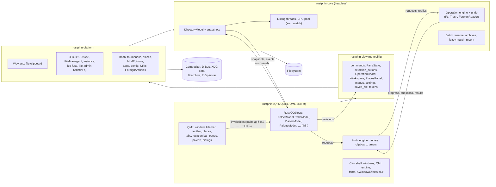

# Architecture

Status: drafted 2026-10-12; brought in line with the code on 2026-11-14, after W-144. Consistent with locked decisions D-002, D-003, D-006, D-008 to D-011, D-017 and D-034 (which superseded D-001).

## Overview

Rustphin is a single desktop process built as a Cargo workspace of four layers. Dependencies point one way: the interface (`rustphin`, Qt 6 and QML through cxx-qt, D-034) depends on the interface logic (`rustphin-view`), which depends on the platform layer, which depends on the core; nothing below the interface depends on Qt. All filesystem and desktop work happens off the Qt thread; the interface renders immutable snapshots and sends commands. Until W-114i (2026-11-14) the interface was `rustphin-ui`, built on GPUI-Kit (D-001); the last GPUI version is commit 72ccb06.

## Components

| Crate | Responsibility | Notes |
|---|---|---|
| `rustphin-core` | Directory model and snapshots, entry storage, listing, lazy details, sorting, name filter, selection, recent folders, fuzzy matching, permission bits, the batch-rename plan, archive formats and their entry and link rules, and the operation engine with undo, the batch-rename journal, compress and extract | No Qt, cxx, Wayland or D-Bus dependency (`rust-tc layers`). Synchronous, cancellable API on its own threads (D-009). The engine reaches the filesystem, the trash and the archive formats it does not read itself only through the `Fs`, `Trash` and `ForeignReader` objects it is given, so tests inject faults and the core carries no libarchive. |
| `rustphin-platform` | File clipboard (Wayland data-control), UDisks2 devices, `FileManager1` service, single-instance bus service, autostart entry, freedesktop trash, thumbnail cache, KDE's places file, MIME detection, icon-theme lookup, applications and `mimeapps.list`, `kdeglobals`, templates, terminal, properties, `/proc` facts, the C allocator's arena limit (`memory`), KWin's window menu (`window_menu`), administrator helper client (`AdminFs`), kio-fuse remote folders, `file://` URI codec, XDG locations and atomic writes of Rustphin's files (`config`), libarchive binding and the 7-Zip/unrar fallback (`ForeignArchives`) | Each capability has a real implementation and a fallback or mock (D-010). No Qt or cxx dependency. The only crate allowed `unsafe` (libarchive FFI, rustix calls), each block with a `// SAFETY:` comment. |
| `rustphin-view` | Interface logic free of any toolkit, as plain data and functions tested headlessly (W-114b, D-034). See the module table below. | No Qt or cxx dependency. Every decision the interface makes about files, keys, menus and operations is made here and returned as data or effects. |
| `rustphin` (binary) | The Qt 6 and QML interface: QML files (`qml/`), Rust QObjects through cxx-qt (each bridge alone in a `*_bridge.rs` file of declarations, D-034), the hub (`hub.rs`), the QML path boundary (`qml_path.rs`), the C++ shell (`cpp/`: windows, the QML engine, bundled fonts, blur) | Never calls the filesystem directly for changes (D-011); listing and metadata come from the core's snapshots. QObjects hold Qt state only and carry out what `rustphin-view` decides. Logs to stderr (`RUSTPHIN_LOG`). |
| `justfile` (via `rust-tc`) | Developer commands and the quality gate: checks, QML lint and format, layering check, minimum-version check, fuzz harness checks, benchmarks | Not shipped. The maintainer's Rust-Toolchain; replaces the `xtask` crate first planned. |
| `fuzz/` | libFuzzer harness, its own workspace | Never linked into the application. See `fuzz/README.md`. |

### `rustphin-view` modules

| Module | Holds |
|---|---|
| `commands` | Every command in one table (W-123): id, label, typed action, keys and which part of the interface catches each key. The palette, Settings' shortcuts page, menu rows, toolbar tooltips and the window's shortcuts read it. |
| `pane_state`, `pane` | One pane between snapshots (W-121, W-122): its folder kept as a path, the listing shown and the newest asked for, selection carried and awaited, the name being edited, failures; `PaneState::arrive` decides what each snapshot changes. `pane` holds the wording: why a folder could not be shown, status line, columns that fit, type-ahead, typed locations, crumbs, fading of hidden and cut entries, the scroll benchmark's verdict. |
| `selection_actions` | What an action on the selection means in the folder shown (W-126): trash or delete, duplicate, new folder or file, extract, compress, batch rename; the result is an engine request, a dialog handed over by ticket (`HandOff`) or something to say. |
| `operation_board`, `operations`, `questions`, `transfer` | The operations' sequencing (W-124): progress, the question in front and what answering means, notices and their expiry, what an operation left out, what is revealed, the cut set. Free of clocks: engine events and their arrival time in, `Launch`/`Reply`/expiry out. `operations` and `questions` hold the words. `transfer` (W-149) measures each operation: a smoothed speed from one sample a second, the time remaining and its wording, the last minute's samples for the speed graph, and the transfer dialog's cards; the board asks to be ticked once a second while something runs. |
| `workspace`, `tabs`, `session` | A window's tabs of one or two panes (W-130): split and join, close and reopen, Alt+number, the session they make; the saved session's format and its ordered background saves. |
| `places_panel`, `groups`, `place_menu` | The places panel's state and decisions (W-127): rows, focus, hide or remove, reorder, drops, folds, rename, headings; place groups and the panel's separators (W-152) in Rustphin's own file (D-008); the panel's menus. |
| `drive_properties` | A drive's Properties (W-153): the ring's figures, its legend and the facts the device service told, from a listed volume and its filesystem's size and free space. |
| `menu`, `archives` | The context menu for the selection, and `OpenMenu`, which numbers the open menu's paths so a stale or disabled choice never runs (W-131); which Extract and Compress entries apply. |
| `palette`, `history` | The palette's results and their selection; the recent folders, read and written on their own thread. |
| `settings`, `settings_form`, `preferences`, `folder_views`, `window_size`, `saved_file` | The settings (D-029) and Settings pages as data; one store for every window, written in the background; each folder's own view; the size new windows open at (W-160); the policy for a saved file that cannot be used (W-140, W-143). |
| `app_chooser` | Open with › Other application…: the type's applications then every other, the search, the choice and whether it becomes the default (W-169). |
| `toolbar_items`, `dialogs`, `properties`, `remote`, `launch`, `location`, `naming` | Toolbar items and what fits; Compress to… and batch rename dialog state; Properties wording; remote-folder names and errors; command-line parsing; a folder as saved (local path or remote address); free names. |
| `layout`, `format`, `icons`, `colors`, `metrics` | View geometry at each zoom, numbers, sizes and dates, Lucide icon names, and the design tokens of `docs/DESIGN.md` with their contrast tests (D-017). |

### Core internals

- **Entry store.** One store per open directory. Names live in a single byte arena (names are bytes, not assumed UTF-8); per-entry fields (kind, size, modified time, name offset) are kept in parallel columns. Details are filled lazily (`details`).
- **Lister.** Reads the directory in batches on its own thread and publishes the first batch immediately. Details are fetched in priority order: visible rows first, then the rest in the background; all of them up front only when the active sort key needs them.
- **Sorter.** Produces an index (a vector of entry indices) on the core's CPU pool (rayon). Natural, case-insensitive comparison; folders first as an option.
- **Snapshot.** An immutable, cheaply shared view: entry store reference, sort index, filter, generation number. The interface reads row *n* in constant time. New snapshots replace old ones; selection is carried across by entry identity. Manual refresh, like a watcher refresh, keeps the current view until the complete replacement is ready. Selection matching by name runs on the core's pool. `PaneState` in `rustphin-view` takes a snapshot only when its generation is the newest asked for, and keeps the previous one for rolling back a failed navigation.
- **Watcher.** inotify events (through `notify`) are coalesced into batched changes applied to the store, followed by an incremental re-sort.
- **Operation engine.** `Operations::new(fs, trash, foreign)` runs each request on a thread of its own and reports progress, questions and results as events on a channel; the session's undo history (the last 100 reversible operations) is in memory. Plan → validate → execute → record completed changes for undo. Plans are data, so they can be previewed (conflicts, batch rename) and tested. Execution follows the D-011 rules: copies are written as `.rustphin-part-…` and renamed into place; nothing is replaced unless the controller chose Overwrite for that entry; delete means trash unless the user chose permanent deletion. Batch rename and batch undo also write a synced recovery record before moving entries (W-071). Regular-file copies sync content and attributes through their open destination handle before the engine publishes the temporary name. Copied folders sync attributes and entries bottom-up through handles opened before final modes. Cross-filesystem moves also sync the published destination parent before deleting any source. A failed publication sync keeps the source and the copy record; retry syncs only. Complete source removal syncs its parent and reports late errors without repeating the move (W-072b). Partial source-tree removal and physical power-loss behaviour are not proven.
- **Archives.** `archive` reads ZIP, TAR (plain, gzip, bzip2, xz, Zstandard) and 7Z in Rust and writes ZIP, TAR, TAR.GZ, TAR.XZ, TAR.ZST and 7Z; any other format is `Format::Foreign` and goes to the `ForeignReader`. Extraction unpacks into a hidden temporary folder inside the destination, checks every entry's name (`entry_path`) and link (`link_stays_inside`), and only then gives the result its place with the usual conflict question, recorded as copied so Undo trashes it. Compression writes a temporary file beside the archive and renames it into place.

### Batch-rename recovery contract (W-071)

- Each affected directory has at most one `.rustphin-rename-journal`. Its presence blocks a new batch rather than overwriting the record. An exclusive nonblocking directory lock serialises Rustphin's batch apply, undo and recovery. It does not lock out unrelated applications.
- The private record is written and file-synced, then its directory is synced before any selected entry moves. Version 1 is binary: `RUSTPHIN-RENAME` plus version byte 1; little-endian directory device/inode and entry count; then each original, temporary and final name (u16 byte length plus raw bytes), kind, device, inode, size, modification nanoseconds and mode. Reads are bounded to 64 MiB and refuse links/nonregular files, malformed lengths, unknown or newer versions, unsafe/duplicate names, wrong directories and trailing data. Staged names are `.rustphin-part-rename-<n>`.
- Recovery is explicit through `Request::RecoverRenameBatch` or `recover_rename_batch`; the palette command is **Files: Recover original names after interruption**. At start, when no other Rustphin runs, the saved tabs' folders and up to 200 recent folders are checked on a background thread, and each record found is recovered at once through that same request, with its progress line and result notice (D-020). Browsing never mutates files to recover them. Only recorded paths in that directory are considered; no path is inferred from a temporary prefix.
- Before moving anything, recovery matches every entry's recorded kind, device, inode, size, modification time and mode, and checks that every occupied destination belongs to the batch. Moves use no-replace rename and recheck entry identity. Missing/edited entries or occupied original names refuse preflight without changes. Later I/O errors can leave a partial recovery; the record remains and the same command can be retried.
- Recovery restores original names, including swaps and an interrupted recovery. With no record it syncs the directory without moving entries (also retries a prior late cleanup sync). Record identity is checked before cleanup; a record another program changed is kept. Ordinary apply errors attempt rollback; successful apply/rollback checks the record identity again before cleanup. Batch undo uses the same recorded transaction path.
- This proves recoverability after explicit recovery, not atomic multi-entry rename at the instant of SIGKILL. Older unjournaled staging files cannot be safely inferred. W-072c syncs completed/rolled-back names before record removal and the directory again afterwards. A failure before removal retains the recovery path; a sync failure after removal reports visible committed names and never rolls back without a record. Power loss, physical-device errors and externally racing namespace changes remain outside the kill/fault proof; no R-103 checkbox was relaxed.

### Namespace limitations (W-072b)

- `Fs::rename_new` requires kernel no-replace rename support. Unsupported filesystems fail instead of using a stat/ordinary-rename fallback, which could overwrite a concurrently created entry. An explicit replace still uses `rename_over`.
- Directory sync errors are actionable operation failures. If copied-directory sync/attributes fail and the user skips, that complete source subtree is kept; the partial destination stays visible with a failure note. Regular copy publication and same-filesystem moves do not yet have a complete namespace-durability contract. Whole cross-filesystem moves sync destination first, source removal last; partial-source removals can reappear as duplicates after a crash. These barriers do not serialize unrelated applications modifying names/content between validation and mutation.

### Atomic configuration writes (W-072a)

- Rustphin's own files (settings, place groups, folder views, session, recent folders), its edits of KDE's shared places file, the autostart entry and `mimeapps.list` use `config::write_atomic`. Each writer exclusively creates a private (0600) temporary file (`<name>.tmp-<pid>-<n>`), avoiding links and concurrent truncation, syncs file content, atomically renames it, then syncs the containing directory. Missing directories and their parent entries are synced while creating the path.
- A pre-publication error cleans only the temporary file created by that writer. A post-publication directory-sync error reports that the replacement is already visible; callers cannot assume an error leaves the old contents. Cleanup errors are also reported. This does not prove physical power-loss safety or serialize competing read/modify/write edits.

### Saved files that cannot be used (W-077g, W-140, W-143)

- `settings.toml`, `place-groups.toml` and `views.toml` (`saved_file`), and `session.toml` (`session`), are each kept exactly as they are for the whole run when they cannot be read, are damaged, or carry a newer format version. Saving that file is turned off for the run and the user is told which file and why; the defaults (or the folders given at launch) are used meanwhile. A missing file is not an issue: it is created on the first save.
- Within a readable settings file, an unknown or invalid single value falls back to its default without stopping saves (`settings` reads leniently).

### Session publication ordering (W-077e)

- The window that restored the session (the start window) saves it when its tabs change. `SessionSaves` numbers each save on the Qt thread; encoding and the atomic write run on a background thread under a mutex that covers the revision check and the complete write. A save older than one already attempted is dropped.
- A completed or failed newer attempt retires older pending saves, so they cannot restore closed tabs. Errors are logged; atomic-file durability is the W-072a contract.
- This orders one window's saves. It is not a cross-process merge, a shutdown flush guarantee or protection against a separate process writing the same file.

### Byte-safe session paths (W-077f)

- Session format 2 stores pane paths as local file URIs through the platform's byte-preserving URI codec, and remote folders by address without password. Valid version-1 UTF-8 absolute paths remain readable, with literal percent signs preserved; supported formats normalise to version 2 on the next save.
- Remote URI hosts on `file:` URIs, relative paths and embedded NUL are rejected before pane/tab clamping. Serialisation returns its error rather than an empty document; the background save reports InvalidData before replacing any file.

### Performance diagnostics (W-073)

- `RUSTPHIN_FRAME_LOG` logs, for each opened folder, the time from asking for the listing to the frame that showed its rows, and Rustphin's own memory. `RUSTPHIN_SCROLL_BENCH` does the same and makes the active list scroll itself once a folder of more than 1,000 entries has loaded; every 1,200 frames it logs a verdict: an interval over 1.5 × the median is dropped, and at most 5 % may drop (D-019).

## Data flow

1. The user acts in QML; QML calls an invokable on a Rust QObject. Paths and names cross as ASCII: a path as its `file://` URI, a bare name percent-encoded (`qml_path`, W-132); structured data (menus, Settings pages, palette targets) goes to QML as JSON. Lossy Unicode text is only ever for display.
2. The QObject asks `rustphin-view` what the action means (`commands`, `selection_actions`, `PlacesPanel`, `Workspace`, `menu::OpenMenu`) and carries out the result: a model command to the core ("open directory", "sort by size"), or an engine request handed to the hub.
3. Core threads do the work and publish snapshots, progress, questions or results on channels.
4. A forwarding thread per channel hands each event to the Qt thread (`post::on_qt`, or a cxx-qt thread handle's `queue`). There `PaneState::arrive` or the hub's `OperationBoard` decides what changes, and the model emits row changes; Qt Quick redraws only the visible delegates.
5. The hub, one per process, owns the user's engine runner (`RealFs`, `FreedesktopTrash`, `ForeignArchives::installed()`) and, while administrator mode is on, a second runner (`AdminFs`, no trash, `ForeignArchives::as_administrator()`); the clipboard; and the notice timers. It outlives the windows, so operations carry on while Rustphin runs in the background.
6. Desktop effects (clipboard, mount, places edits, remote mounts) are calls from the interface into platform code on background threads; blur is requested from KWin by the C++ shell (`KWindowEffects`).

Stale results are discarded by generation number, so a fast navigation never shows a previous directory's late results.

## Trust & boundaries

- **Authn/z:** none of its own. Rustphin runs with the user's permissions and never elevates itself.
- **Acting as administrator (W-098, D-028; design and threat model in ADMIN_MODE.md):** the one privileged path is KDE's own `kio-admin` helper on the system bus. Rustphin never asks for, sees or stores a password: polkit (`org.kde.kio.admin.commands`, `auth_admin_keep`) authorises Rustphin's own bus connection, and KDE's agent asks. The mode is never saved. `AdminFs` (platform) is the only code that talks to the helper; the core sees it as one more `Fs`, so every change still goes through the operation engine (temporary name, verify, no silent overwrite, D-011). Data from the helper is untrusted: `UDSEntry` parsing is bounded and fuzzed (`admin_entry`); only plain absolute UTF-8 paths that round-trip exactly are sent, as percent-encoded `file://` URLs. The helper offers no trash, watching, locks or `fsync`: delete is always permanent and confirmed, panes re-read after each change, batch rename is off, a move across filesystems keeps its source, and Extract and Compress are refused with a reason (W-140). Each call is limited to 120 s.
- **Archives (W-111, W-129, W-133, D-032, D-036):** archives are untrusted. ZIP, TAR and 7Z are parsed by Rust crates in the core; every other format by libarchive, the system's C library linked by `rustphin-platform` (Rustphin's own small binding: names stay bytes, nothing from libarchive is kept past its call), reading the archive the engine opened through `Fs`. What libarchive cannot read (encrypted RAR and 7Z, ARJ…) goes to an installed 7-Zip or unrar run as a separate process into a private `0700` work folder under `~/.cache/rustphin`, removed when the read ends. Whichever reads it, the engine gets entries one by one and alone decides what is written: names are checked (`archive::entry_path`: no absolute name, `..`, NUL or empty name); a link is made only if its target climbs with leading `..` parts alone and stays inside the destination, never with a `..` after a name (`x/../y`), because a name on the way may be a link the same archive makes (W-133); every folder that holds an entry is made as a real folder, never followed through a link; only files, folders and such links are made, and everything is written through `Fs` under temporary names. A memory-safety fault in libarchive would be in-process; it is the distribution's library, kept current by it. A tool gets the engine's password on its command line, readable by the user's own processes while it runs. The administrator runner's reader has no tool fallback: it refuses what libarchive cannot read.
- **Trash records (W-137):** `.trashinfo` files are untrusted, especially on removable volumes, where anyone with the medium can write them. A record whose path contains `..` is not offered for restoring; a volume trash's record must restore inside its own volume; absolute paths are accepted only from the home trash.
- **Saved files (W-140, W-143):** Rustphin's own files are parsed defensively and never overwritten when they could not be used (see "Saved files that cannot be used").
- **Other untrusted input:** directory contents (names with control characters or invalid UTF-8), file contents handed to the thumbnailer, `.desktop` files, the shared places file, network-folder `.desktop` files under `remoteview/`, clipboard and drag payloads from other applications, and `FileManager1` requests from any local process. All are parsed defensively; none can trigger execution. Activating an executable or `.desktop` file asks first (Settings, Confirmations). A typed `scheme://` address that does not parse is refused rather than opened as a relative path (W-140).
- **Thumbnailing:** memory-safe Rust decoders (BMP, GIF, JPEG, PNG, WebP) with file-size, image-edge and decode-memory limits, on a thumbnail thread; a decoder panic is caught and failures yield a failure marker and the type icon. There is no wall-clock limit per image.
- **Data sensitivity:** paths and names of the user's files. They stay on the machine: no network use, no telemetry (R-108). Warnings and errors can include paths at the default log level; see PRIVACY.md for every file written, retention and clearing.
- **External calls:** Wayland compositor, session D-Bus (FileManager1, instance, kio-fuse, KWin's global shortcuts, accessibility), system D-Bus (UDisks2, kio-admin), launched applications and the terminal, 7-Zip/unrar. `deny.toml` bans HTTP clients, TLS stacks and telemetry crates. Qt's QML module links Qt Network, but Rustphin's QML is loaded from its own resources. Environment-selected D-Bus transports are not restricted to Unix sockets. See PRIVACY.md.

## Failure modes

| Failure | Detection | Response / recovery |
|---|---|---|
| Directory unreadable or vanishes while open | Error from listing or watcher | In-place message saying why, with Go back or Go up when there is somewhere to go; a removed folder leads to the nearest existing parent, and the pane says so |
| Copy or move interrupted (crash, power loss, cancel) | Operation error/cancel, or `.rustphin-part-…` files left after a crash | Error/cancel paths remove the temporary copy; copied regular files are synced before publication. Fault tests cover copy/move; a process-kill test covers cross-filesystem moves. Namespace ordering, copy restart cleanup and power-loss validation remain open (W-072) |
| Batch rename or its undo interrupted | Per-directory recovery record with staged/original/final entries | Explicit validated recovery restores original names; interrupted recovery is retryable. Unknown or changed entries and records are retained, never guessed at or replaced (W-071) |
| Destination full or permission denied mid-operation | I/O error from the engine | The operation asks: skip / retry / cancel; completed changes stay recorded for undo |
| Extraction fails, wrong password, or Stop | Error, password question, cancel | The hidden temporary folder is removed, so nothing half extracted shows; a wrong password is asked again |
| Archive format not readable | libarchive probe refuses; no 7-Zip/unrar installed | The operation fails with the reason and what to install |
| Shared places file changed or malformed | Watch on its folder; parse error | Reload; on a parse error keep the panel as it was, say so, and refuse edits so the file is never written over |
| Place-group file refers to a vanished place ID | Reconciliation at load and on change | Drop the member; keep the group |
| Own saved file unreadable, damaged or newer | Read or parse error, version check | Kept unchanged; saving it is off for the run; the user is told (W-140, W-143, W-077g) |
| KWin offers no blur | `KWindowEffects::isEffectAvailable` | Opaque theme (D-017, D-010); also forced by `RUSTPHIN_OPAQUE` |
| Data-control protocol missing | Runtime protocol detection | In-app clipboard only; the first copy or cut says pasting works only inside Rustphin |
| UDisks2 absent or unresponsive | D-Bus error | No volumes listed and a warning logged; the rest of the app unaffected |
| Thumbnail decoder fails or exceeds limits | Error, limit or caught panic on the thumbnail thread | Type icon; failure marker in the shared cache per the specification |
| Panic on a worker thread | — | Only that thread ends; shared locks recover from poisoning, so other operations and panes continue. A thumbnail panic is caught (above); other panics are not reported to the user |
| Administrator helper missing, refuses, or times out | Bus error; polkit refusal; 120 s limit per call | "Install kio-admin" or "not granted" notice and the mode stays off; a timed-out operation fails with its reason |
| Remote folder cannot be mounted | kio-fuse error or timeout | Message saying why (`rustphin_view::remote`); nothing is mounted |

## Test strategy

- **Unit and property tests (core):** sorting, natural comparison, snapshot consistency, selection carry-over, rename planner, fuzzy ranking, operation plans, archive names and links, the recovery record's parser. Property tests (`proptest`, failures kept in `proptest-regressions/`) generate operation sequences and damaged recovery records and check invariants: any sequence of operations is undone back to the starting tree, and a damaged record never moves an entry.
- **Fault injection (core):** `ops/faults.rs` makes the real filesystem fail at chosen steps of copy, move, trash, extract, compress and batch rename; assertions check the D-011 rules. Kill tests run a child process of the test binary against a temporary directory and kill it at a chosen step. Other crates' tests use the faulty filesystem through the core's `test-support` feature.
- **Integration and contract tests (platform):** places file round trips against fixtures from a real Dolphin; trash and thumbnail cache against their specifications; UDisks2, FileManager1, the instance service, kio-fuse, KWin's window menu and the admin helper against a private peer-to-peer bus; libarchive against the fixtures in `tests/fixtures/archives`; stand-in scripts for 7-Zip and unrar; temporary homes through injectable XDG locations.
- **Interface logic (`rustphin-view`):** every decision tested headlessly: `PaneState`, `OperationBoard`, `Workspace`, `PlacesPanel`, `selection_actions`, menus, Settings pages, the saved-file policy. The command table is checked for clashing keys and against KEYBOARD.md; the colour tokens for WCAG AA contrast.
- **Interface (`rustphin`):** unit tests for the Rust beside the QObjects (paths across QML, model roles, toolbar tooltips, icon names) and a few contracts read from the QML files; `rust-tc doctor` runs `qmlformat` and `qmllint` with the BestPractices plugin, and the build compiles every QML file with qmlcachegen.
- **Mutation testing:** `rust-tc mutants` (cargo-mutants), on demand. Surviving mutants are killed with a test or recorded as equivalent in VALIDATION.md (W-134, W-139, W-142).
- **Fuzzing:** the separate `fuzz/` workspace targets URI lists and name display (`uri`), places parsing and edits (`places`), desktop classification and Exec parsing (`desktop`), thumbnail generation (`images`), kio-admin entries (`admin_entry`) and archive names, links and the Rust readers (`archive_entry`). `rust-tc fuzz <target> [seconds]` runs a bounded libFuzzer/AddressSanitizer campaign from reviewed seeds. `rust-tc doctor` includes the harness's format, lint and dependency-policy checks (`fuzz-check`); campaigns run explicitly. libFuzzer never ships in the application.
- **Benchmarks:** headless listing, details and sort on a generated 500,000-entry directory (`rust-tc bench-listing`, R-101) and palette ranking over 10,000 recent locations (`rust-tc bench-palette`, R-015); both fail when their thresholds are missed. Frame rate is measured in the running app with `RUSTPHIN_SCROLL_BENCH`.
- **Accessibility:** Qt Quick exposes the views over AT-SPI (`QT_LINUX_ACCESSIBILITY_ALWAYS_ON=1` in test sessions): entries are list items by name with their selected state, buttons are named with actions, dialogs carry their title (W-114h). There is no Orca pass (D-023).
- **UI tests:** the scenarios in UI_SCENARIOS.md, replayed through kwin-mcp in an isolated KWin session with an isolated home, alongside the installed Dolphin: navigation, drag and drop, clipboard, tabs, palette, operations, archives, administrator mode against `fake_admin_helper`, background mode. Results are recorded in VALIDATION.md.
- **Manual checklists:** keyboard-only operation (KEYBOARD.md), visual review and blur on the real desktop, a real USB drive, a non-KDE drop target.
- **Risk-specific:** no file-operation UI is usable on real data until the engine's fault-injection suite passes.

## Operability

- **Config:** TOML under `$XDG_CONFIG_HOME/rustphin/` (`settings.toml`, `place-groups.toml`) and `$XDG_STATE_HOME/rustphin/` (`session.toml`, `recent-locations.toml`, `views.toml`). Formats carry version fields; newer versions are protected from writes. There is no general migration/backup framework or configurable key-binding file. Writes use synced temporary files and atomic rename (W-072a); see PRIVACY.md.
- **Secrets:** none are stored. Archive and remote-folder passwords pass through to the engine or kio-fuse and are never logged or saved.
- **Logging/metrics:** `tracing` to stderr, filtered by `RUSTPHIN_LOG` (default `info`); Qt's own warnings go to the journal unless `QT_FORCE_STDERR_LOGGING=1`. No application log file, rotating store or diagnostics view. Opt-in `RUSTPHIN_FRAME_LOG` and `RUSTPHIN_SCROLL_BENCH` print timings to stderr. No telemetry collector. Logs can contain paths; see PRIVACY.md.
- **Lifetime:** one Rustphin per session owns `org.rustphin.Rustphin`; later launches hand their folders over and exit; it keeps running without windows when Settings says so (W-110, D-031), and `rustphin --quit` ends it.
- **Migrations:** only Rustphin's own config files; shared files are never migrated.
- **Rollback sketch:** Rustphin never replaces Dolphin. Reverting means changing the default file manager back; shared data (places, trash, thumbnails) stays valid for Dolphin at all times. No releases are tagged yet; a previous build is rebuilt from its commit.
- **Checks:** `rust-tc doctor` runs format, `qml-format`, clippy, tests, doctests, `qml-lint`, `cargo-deny` (advisories, licences, bans, sources), `cargo-shear`, feature checks, the layering check, a compiler check on Rust 1.100 (D-035; not a linked clean build) and `fuzz-check`. `rust-tc build` links the locked release application without launching it. `rust-tc validate` runs doctor and both headless benchmarks sequentially, propagating failures. All local; the repository is on GitHub (D-037) but there is no hosted CI.

## Alignment to locks

- D-001 → superseded by D-034 (W-114i): the interface is Qt 6 and QML through cxx-qt in the `rustphin` crate; `deny.toml` bans `gpui-kit` and `gpui-pre`.
- D-002 → four layers with one-way dependencies, enforced by `rust-tc layers` (no Qt or cxx below the interface, no Wayland or D-Bus in the core, no GPUI anywhere).
- D-003 → every crate declares GPL-3.0-or-later; licences checked by `cargo-deny`.
- D-006 → Wayland only; no X11 backend.
- D-017 (supersedes D-007) → the tokens in `rustphin-view` (`colors`, `metrics`) implement `docs/DESIGN.md`; `crates/rustphin/src/tokens.rs` hands them to QML; the opaque theme is used when KWin offers no blur or `RUSTPHIN_OPAQUE` is set.
- D-008 → the `places` module in the platform layer reads and writes the shared file; place groups live in `place-groups.toml`, keyed by place ID.
- D-009 → core-owned threads and pool, snapshots over channels, no async runtime in the core.
- D-010 (amended by D-034) → the file clipboard in `rustphin-platform` with runtime detection and an in-app fallback; blur comes from KDE's `KWindowEffects` on each window, with the opaque theme when it is unavailable.
- D-011 → single operation engine in the core; the interface has no filesystem access for changes; `Fs`, `Trash` and `ForeignReader` are given to the engine, so tests inject faults.
