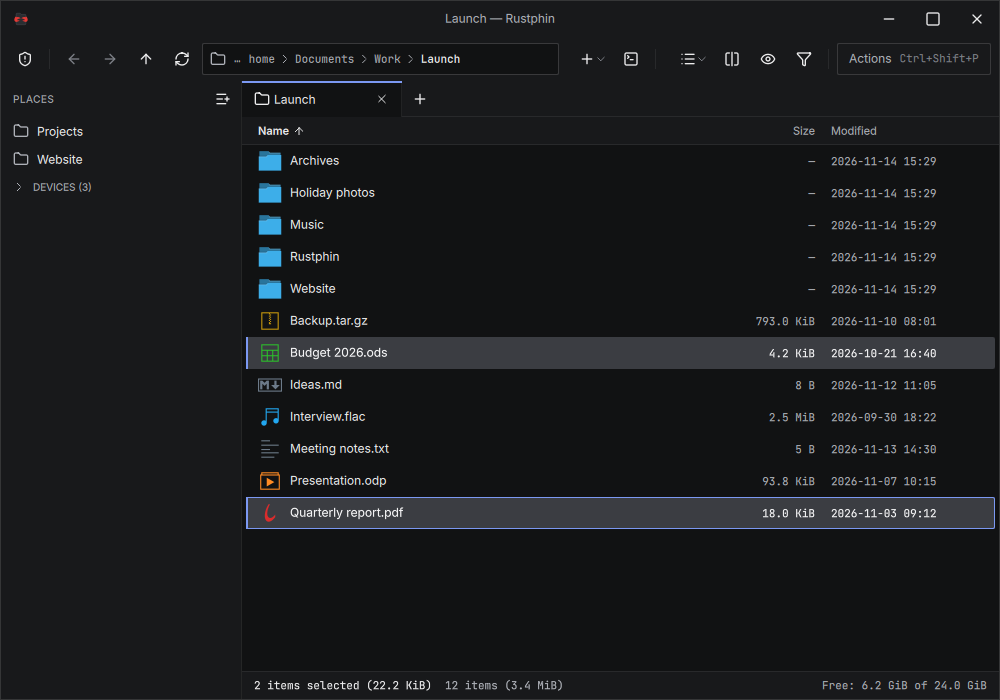

The first release of Rustphin: a fast, keyboard-friendly file manager for KDE Plasma on Wayland, written in Rust with a Qt 6 Quick interface.

## What's in it

**Browsing:** details, icons and compact views with zoom and sorting; tabs and a split view; live updates; a filter bar; breadcrumbs that become an editable location field; thumbnails from the shared freedesktop cache.

**Places:** KDE's places, shared with Dolphin, plus place groups and separators of your own. Drives with their free space as bars, compact lines or rings; removable drives with Mount and Eject on the row; remote folders through kio-fuse.

**Files:** copy, move, rename, duplicate and new files from templates, through the clipboard or drag and drop, all done by one operation engine that writes under temporary names and never overwrites without asking. Trash with restore, undo, batch rename with a preview, compress and extract (ZIP, TAR and 7Z built in, more through libarchive), Properties, and an administrator mode through KDE's kio-admin.

**Everywhere:** a command palette (Ctrl+Shift+P) for every action, place, tab and recent folder; Dolphin's shortcuts; a Settings window you can search; a transfer line with speed and time left; a background mode so new windows open at once; "Show in folder" from other applications.

## Installing

Rustphin runs on Linux with KDE Plasma 6 on Wayland. There is no package yet (an Arch `PKGBUILD` is planned for 0.2.0): build it from source as the [README](https://github.com/PerkyZZ999/Rustphin#building-and-installing) describes. It needs Rust 1.100 or newer, Qt 6, KF6 WindowSystem and libarchive.

## Known limits

- Not yet tried on real hardware: mounting a real USB drive, and the frosted glass on every desktop.
- In batch rename's Pattern, `@` keeps the extension, so `@-#` gives `photo.jpg-1`; write the extension in the pattern (`Holiday ##.jpg`) for now.
- No search, information panel, quick preview or KDE service menus yet.

## What's next

0.2.0, "Daily driver": fixes and hardening, an Arch package, KDE service menus and quick preview with Space. See the [roadmap](https://github.com/PerkyZZ999/Rustphin/blob/main/docs/project/ROADMAP.md).

Rustphin is free software under the GPL-3.0-or-later.
